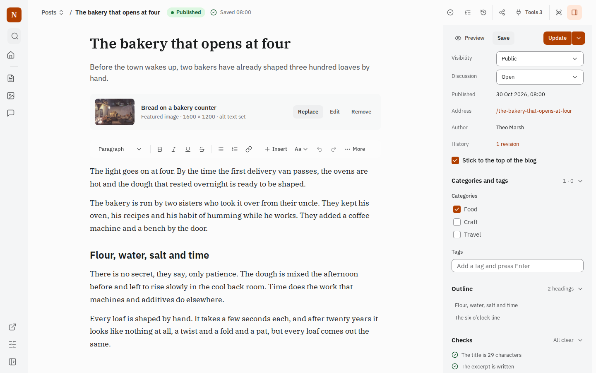
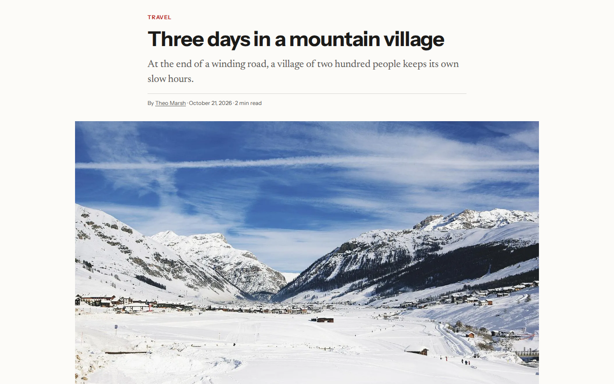
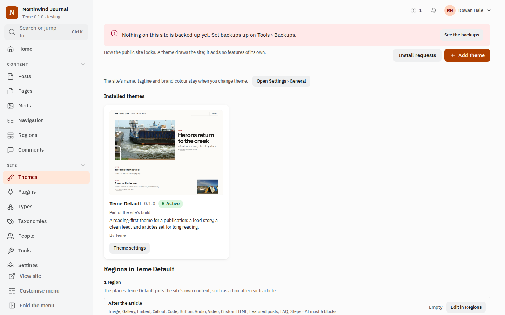
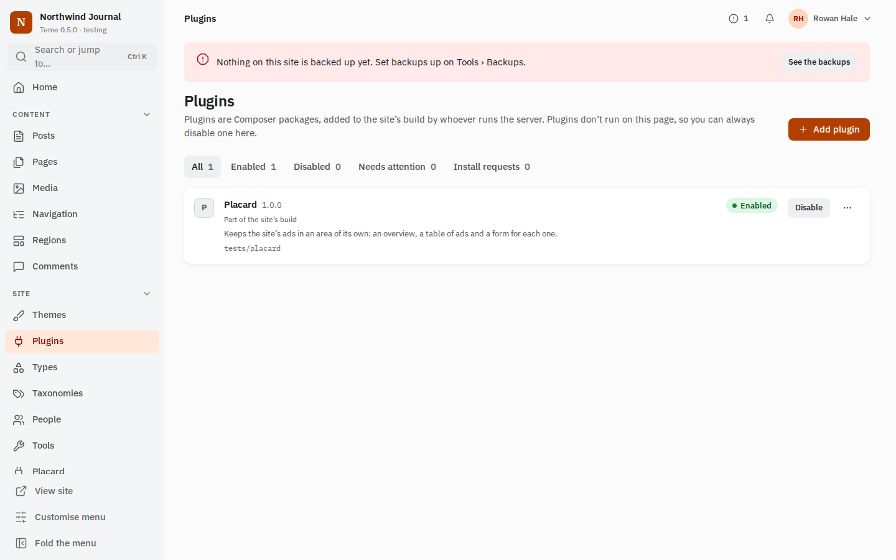
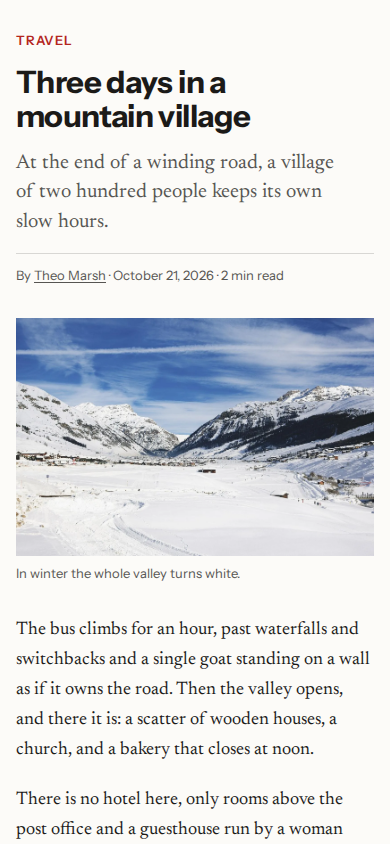

<p align="center"></p>

<h1 align="center">TemeCMS</h1>

<p align="center"><em>Made to create.</em></p>

<p align="center"><strong>For publishers: newsrooms, magazines and writers who want their site, their archive and their backups in their own hands.</strong></p>

<p align="center">Teme (Ijaw for <em>create</em>) is an open-source content management system for publishers, built on Laravel and PostgreSQL.</p>

<p align="center">
  <a href="docs/guides/operators/install.md">Install</a> ·
  <a href="docs/guides/README.md">Guides</a> ·
  <a href="docs/screenshots/README.md">Screenshots</a> ·
  <a href="docs/roadmap.md">Roadmap</a> ·
  <a href="CHANGELOG.md">Changelog</a> ·
  <a href="https://github.com/temecms/teme/releases">Releases</a>
</p>

<p align="center">
  <a href="https://github.com/temecms/teme/releases"></a>
  <a href="https://github.com/temecms/teme/actions/workflows/tests.yml"></a>
  <a href="LICENSE"></a>
  
  
  
</p>

<p align="center"><a href="docs/screenshots/README.md"><picture><source media="(prefers-color-scheme: dark)" srcset="docs/screenshots/editor-dark.png"></picture></a></p>

It holds everything a publishing site needs in one place: the editor, media, people and permissions, publishing, the public website, themes, plugins and backups. Content is stored as structured documents, every item keeps its fields together in one row, and a site moves to a new domain by changing one setting.

## Status

Teme is in **alpha**. Every release is on [Releases](https://github.com/temecms/teme/releases), the [changelog](CHANGELOG.md) says what each one added, and [the roadmap](docs/roadmap.md) says what comes next. It is developed in the open: features arrive in small releases, and the interface is being redesigned now. Try it, but don't run a site you can't afford to lose on it yet.

## Run a site

<a href="https://github.com/temecms/temecms-for-dokploy"></a>

In Dokploy, choose **Create Service › Template**, paste the Base URL `https://raw.githubusercontent.com/temecms/temecms-for-dokploy/main`, choose **TemeCMS** and deploy. [temecms-for-dokploy](https://github.com/temecms/temecms-for-dokploy) has the steps, and [the Dokploy guide](docs/guides/operators/platforms/dokploy.md) the details.

- **Coolify:** [Running Teme on Coolify](docs/guides/operators/platforms/coolify.md).
- **A plain server:** [the plain VPS guide](docs/guides/operators/platforms/plain-vps.md), with the Compose recipe and an HTTPS proxy of its own.
- **One container:** [the one-container guide](docs/guides/operators/platforms/one-container.md), for a host that runs a single image with a database and a volume.

Every way runs the public image `ghcr.io/temecms/teme` at an exact release tag. [Installing with the Compose recipe](docs/guides/operators/install.md) walks through it from the start.

## Why Teme

- **Content is structured editor JSON, never HTML.** What the editor writes is the stored document, so it can be rendered, searched and moved without picking apart markup.
- **Moving to a new domain is one setting.** Links and media are stored by ID and turned into addresses when a page is drawn, so nothing in your content needs rewriting.
- **Plugins are packages that ask before they act.** Each one declares what it needs, and its work runs only for the person who started it.
- **Backups are encrypted and test-restored.** Every night Teme backs up, encrypts the copy and proves that it restores.
- **AI works under the same permissions as people.** An assistant can do only what the person using it may do, through the same operations.
- **PostgreSQL, and one row per item.** Every item keeps its fields together in one row, so a large archive stays fast.

## What it does

- **Write and publish:** a block editor, revisions and autosave, scheduling, previews, and review before publishing.
- **People and credits:** roles, invitations, two-factor sign-in, and bylines that can credit several people, with or without an account.
- **Organize:** categories and tags, pages under pages, menus, redirects, and addresses that follow a pattern you choose.
- **Media:** a library with image sizes made for you, alt text and captions.
- **Comments:** threads, moderation, spam checks and their emails.
- **Search and social:** titles, descriptions, sitemaps, feeds, structured data, and checks as you write.
- **Ready for AI and tools:** with one switch, `llms.txt` and a plain Markdown copy of every published item at its address ending `.md`.
- **A fast public site:** a page cache that clears itself when content changes.
- **A read API:** published content as JSON at `/api/v1`, for apps and other sites.
- **Themes and plugins:** themes for the look; plugins as Composer packages, with hooks that fire after every change is saved.
- **Several languages:** every item carries a language, and translations are linked as versions of one item.
- **Import:** bring an existing WordPress site across, with every old address still answering.
- **Backups:** to a folder, S3-compatible storage or an SFTP server.
- **Deploy:** one Docker image and a Compose recipe, ready for Dokploy, Coolify or a plain server.

## Tour

<table>
  <tr>
    <td><a href="docs/screenshots/"><picture><source media="(prefers-color-scheme: dark)" srcset="docs/screenshots/editor-dark.png"></picture></a><br>The editor</td>
    <td><a href="docs/screenshots/"><picture><source media="(prefers-color-scheme: dark)" srcset="docs/screenshots/article-dark.png"></picture></a><br>An article on the site</td>
  </tr>
  <tr>
    <td><a href="docs/screenshots/"><picture><source media="(prefers-color-scheme: dark)" srcset="docs/screenshots/design-dark.png"></picture></a><br>Themes</td>
    <td><a href="docs/screenshots/"><picture><source media="(prefers-color-scheme: dark)" srcset="docs/screenshots/plugins-dark.png"></picture></a><br>Plugins</td>
  </tr>
  <tr>
    <td colspan="2" align="center"><a href="docs/screenshots/"><picture><source media="(prefers-color-scheme: dark)" srcset="docs/screenshots/article-phone-dark.png"></picture></a><br>On a phone</td>
  </tr>
</table>

## Guides

- [**The operators' guide**](docs/guides/operators/README.md): installing, configuring, HTTPS, updating, backing up and restoring, and moving an existing site onto Teme.
- [**The editors' guide**](docs/guides/editors/README.md): writing, publishing, media, comments and settings, in the words the admin uses.
- [**The developer handbook**](docs/guides/developers/README.md): building plugins and themes, from a first package through manifests, hooks, operations and testing.

## Work on Teme

You need PHP 8.4, Composer 2, Node 24 (see `.nvmrc`), and Docker for PostgreSQL 18 and Valkey.

```bash
docker compose up -d      # PostgreSQL, a second PostgreSQL for the tests, and Valkey
composer setup            # dependencies, .env, the key, the database and the front end
composer dev              # the app, the queue, the logs and Vite together
```

`composer check` is the gate: Pint, PHPStan, the type checks, the architecture tests, then the whole suite. `composer check:browser` runs the browser tests. Tests run against PostgreSQL.

Before changing anything, read [`AGENTS.md`](AGENTS.md): the rules every change keeps.

## Documentation

| Where | What |
|---|---|
| [`docs/architecture/`](docs/architecture/) | How each part works: operations, content, addresses, plugins, themes, security and more |
| [`docs/reference/`](docs/reference/) | Generated from the code: settings, fields, cards, the theme view data and the export format |
| [`docs/roadmap.md`](docs/roadmap.md) | What is built and what comes next |
| [`CHANGELOG.md`](CHANGELOG.md) | What changed in each release |

## Help and community

- **A bug:** [report it](https://github.com/temecms/teme/issues/new?template=bug.yml) with the bug form.
- **An idea:** [suggest it](https://github.com/temecms/teme/issues/new?template=feature.yml) with the feature form.
- **A question:** [open an issue](https://github.com/temecms/teme/issues) for now.
- **A security problem:** report it privately through GitHub's [private vulnerability reporting](https://github.com/temecms/teme/security/advisories/new), as [`SECURITY.md`](SECURITY.md) describes, never in a public issue.

To contribute, read [`CONTRIBUTING.md`](CONTRIBUTING.md). Everyone taking part follows the [code of conduct](CODE_OF_CONDUCT.md), and [`GOVERNANCE.md`](GOVERNANCE.md) says how decisions are made.

## Who makes it

Teme is designed and maintained by [Kingsley Ibietela Felix](https://github.com/iamkingsleyf), and published by [Krafty Sprouts Media LLC](https://kraftysprouts.com).

If Teme is useful to you, a star on GitHub helps others find it.

## License

TemeCMS is open source under the [MIT license](LICENSE), © Krafty Sprouts Media LLC. The names TemeCMS and Teme, and the logo, are trademarks; [`TRADEMARK.md`](TRADEMARK.md) says how you may use them.
